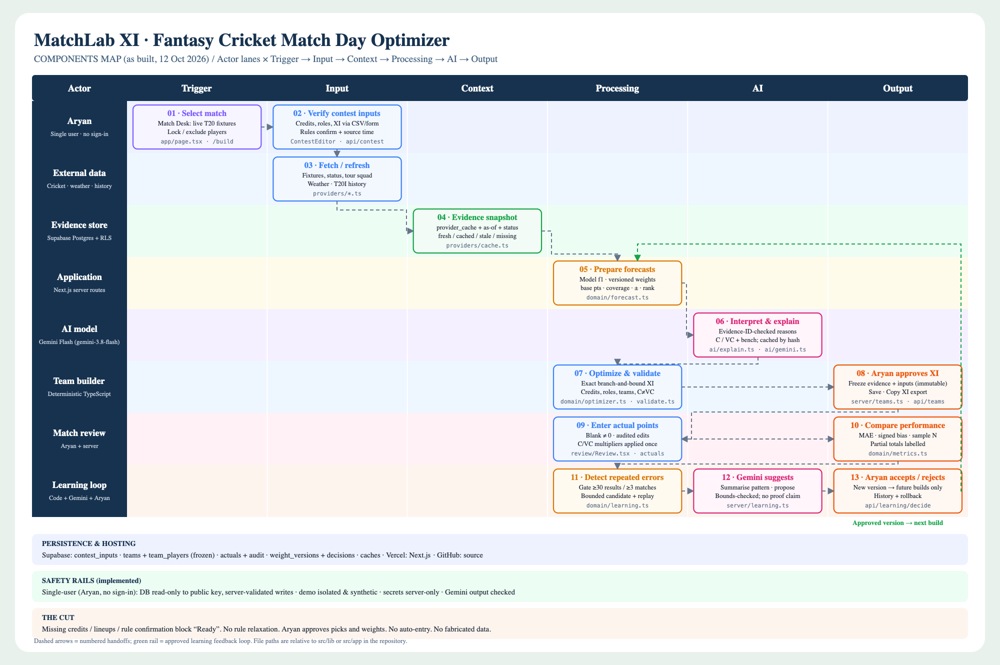

# MatchLab XI — Fantasy Cricket Match Day Optimizer

Evidence-first Dream11 team building for a serious fantasy player (Aryan): pick a real T20 fixture, see every forecast with its source and freshness, build a rule-valid XI with an exact optimizer, get match-specific captain / vice-captain reasons from **Gemini Flash**, freeze the prediction, enter actual points after the match, and let a **human-approved learning loop** correct repeated forecasting errors.

- **Live app:** https://matchlab-xi-two.vercel.app (no sign-in: real fixtures, Aryan's workspace and a fully labelled synthetic demo)
- **Repository:** https://github.com/karankulkarni-2210/matchlab-xi
- **Components map:** [`docs/component-map.png`](docs/component-map.png) (source: [`docs/component-map.svg`](docs/component-map.svg))
- **Test results:** [`docs/TEST_RESULTS.md`](docs/TEST_RESULTS.md)



## Screens

| Screen | What it does |
| --- | --- |
| **Match Desk** (`/`) | Upcoming T20 fixtures fetched live from CricketData (tracked series: West Indies tour of India 2026, Sri Lanka tour of Pakistan 2026), with source/freshness badges, provider data-quality warnings (e.g. T20Is mislabelled `odi`), and the synthetic demo. |
| **Build XI** (`/build/[matchId]`) | Three-panel desktop layout (context · pitch · "Why this pick?") that stacks on a 390 px phone (context → pitch → pool → contest/sources) with a bottom evidence sheet and a sticky validity/action bar. Exact optimizer, swaps, C/VC edits, lock/exclude, re-validation on every change, Gemini reasons, contest CSV/form editor, Save (freeze) and Copy-XI export. |
| **Match Review** (`/review`) | Enter actual Dream11 **base** points per selected player (blank = not entered, `0` = real zero). Errors are `predicted − actual` (positive = overprediction). MAE/bias over entered players only with N; final total hidden until all 11 are entered; predicted-vs-actual scatter omits pending players. |
| **Learning Lab** (`/learning`) | MAE, signed bias, sample sizes by role/context; repeated-pattern detection behind a minimum-evidence gate; Gemini summary + bounded weight proposal; Accept / Keep current; version history with rollback. *Demo (synthetic)* and *Aryan's matches* are separate tabs and never mixed. |

## Architecture

```
Next.js 16 (App Router, TypeScript, Tailwind v4) on Vercel · Supabase Postgres (RLS) · no sign-in (single-user)
├─ src/lib/domain/        pure, unit-tested logic (no I/O)
│   rules.ts  validate.ts  optimizer.ts  forecast.ts  metrics.ts  learning.ts  weights.ts  scoring.ts  contestCsv.ts
├─ src/lib/providers/     CricketData, Open-Meteo, Cricsheet history; cache with fresh/cached/stale/missing status
├─ src/lib/ai/            Gemini Flash JSON calls (schema + ID validation, hash cache, 429/timeout handling)
├─ src/lib/server/        match bundle, contest, build pipeline, teams/actuals, learning, scopes (read: public key · write: server only)
├─ src/app/api/*          route handlers (build, explain, contest, teams, actuals, learning, demo reset, health)
└─ supabase/migrations    schema, RLS, immutability triggers, audit trail, grants
```

**Data sources (all free):**
- **CricketData.org** (free plan, 100 hits/day): `series_info`, `match_info`, `match_squad` (10 hits each on the free plan). Cached: fixtures 3 h, status 20 min, squads 12 h; failed refreshes serve the last good snapshot marked **stale**. Responses also sit in Vercel's data cache, with the provider's own `Date` header as the as-of time.
- **Cricsheet** men's T20I ball-by-ball (2,412 matches, 2022-01-22 → 2026-10-06), pre-aggregated by `scripts/build-history.ts` into `data/history/t20i_male.json` (ODC-BY 1.0, attributed in-app).
- **Open-Meteo** forecast + geocoding at the scheduled start hour (CC BY 4.0).
- **Owner-entered contest data** (CSV or form): Dream11 credits, contest roles, lineup status, rule confirmation, source label and timestamp. MatchLab never estimates credits or lineups.

## Forecast model `f1` (all quantities in Dream11 T20 base points, before C/VC)

```
baseline   = (n_b·mean(last ≤20 pts) + 4·prior_role) / (n_b + 4)        prior_role = dataset mean × role factor (assumption)
form       = (n_f·recencyMean(last ≤5, weights 5..1) + 2·baseline) / (n_f + 2)
opportunity= baseline · (1 + (clamp(inv5/inv20, 0.6, 1.4) − 1)·n_f/(n_f+2)),   inv = balls faced + balls bowled
venue      = (n_v·mean(pts at venue) + 3·ctx) / (n_v + 3),   ctx = 4 + bat_b·batIdx* + bowl_b·bowlIdx* + field_b,  idx* = 1 + (idx−1)·N/(N+30)
matchup    = (n_m·mean(pts vs opponent) + 3·baseline) / (n_m + 3)
predicted  = roleMultiplier[role] · Σ w_f · factor_f                 (weights v1: form .45, opportunity .25, venue .20, matchup .10)
coverage   = Σ w_f · min(1, n_f / target_f)                          targets: form 5, opportunity 10, venue 3, matchup 3
uncertainty= sd_shrunk · (1 + 0.5·(1 − coverage))                    "± typical spread", not a confidence interval
ranking    = predicted · availability · (0.9 + 0.1·coverage)        availability: XI 1.0, probable 0.9, squad 0.75, out 0
```
History strictly before the match date is used (no leakage). Ranking score, predicted base points, coverage and uncertainty are separate fields everywhere (UI, API, database).

**Historical points** come from `scoring.ts`, an approximation of the official Dream11 T20 table (runs, boundary/six bonuses, milestones, duck, SR/economy bands, wickets +30, LBW/bowled +8, hauls, dot balls, maidens, catches, stumpings, run-outs, +4 lineup). Role-dependent rules are approximated from bowling usage. These are evidence inputs, never shown as anyone's actual points.

## Optimizer & rules

- Exact **branch-and-bound** over eligible players maximising `Σ ranking + (C−1)·best + (VC−1)·second`, with pruning on credits, role minimums/maximums, team limits and locked players. A brute-force cross-check is in the tests.
- Confirmed-out players, unknown credits and unknown roles are excluded **with reasons**. If no XI exists, the API returns specific violations (pool too small, role shortages, cheapest valid XI over the cap…). Rules are never relaxed.
- **Rule presets.** Dream11 publishes no machine-readable rules, and its rules page was unreachable when we checked. The default **strict-compatible** preset (max 7 per team; WK 1–4, BAT 3–6, AR 1–4, BOWL 3–6; 100 credits; C 2×, VC 1.5×) is the intersection of the two published variants, so a valid strict team is also valid under the expanded variant (max 10 per team, 1–8 per role), which is offered as a second preset.
- **Ready** requires: valid team **and** owner-confirmed rules, a source timestamp on credits/roles, and confirmed XIs for both teams that include every selected player. Otherwise the team is at most **Valid · provisional**.
- Every swap or C/VC change re-runs server validation. Bench reasons come from the best valid single swap or the binding constraint.

## Gemini Flash (runtime AI)

- Model: `GEMINI_MODEL` (verified available on the configured key: `gemini-3.8-flash`). Non-Flash ids are refused.
- **Explanations:** Gemini receives only the evidence JSON (validated player keys + evidence ids). Output must match a zod schema; every player key and evidence id is checked against the inputs, and anything invalid is rejected (never clipped). If Gemini is unavailable, a deterministic template built from the same evidence is shown, labelled as such.
- **Learning proposals:** Gemini summarises flagged patterns and proposes weights. Its numbers must pass `checkProposalBounds` (±0.10 per factor, each in [0.05, 0.70], sum to 1; role multipliers ±15% within [0.7, 1.3]). If they fail, the deterministic candidate is used and the UI says so.
- Results are cached by `sha256(kind, model, prompt version, evidence)`. A local rate limit (8/min) and 429/timeout handling fall back to cached output, which is always labelled **cached** with its timestamp.

## Learning loop

1. Records = frozen factor estimates + predicted base + owner-entered actuals (blank excluded, zero included).
2. **Gate:** ≥30 player results across ≥3 matches. A group (role or context) is flagged only with ≥12 results, ≥3 matches, |bias| ≥ max(4, 12% of mean prediction), and the same direction in ≥60% of its matches.
3. **Bounded candidate:** role multiplier shrinkage `1 − (n/(n+20))·bias/meanPred` (±15%), plus a grid search of factor weights within ±0.10. It is replayed on the stored records and labelled *in-sample, not validated*.
4. Gemini summary/proposal → stored as `proposed` → the owner **accepts** (it becomes active for future builds only) or **rejects**. Every decision is recorded, and older versions can be **rolled back**.
5. Frozen teams keep their `weight_version_id` and `forecast_version`. Database triggers reject any update to `teams` / `team_players`, even from the service role.

## Security & data protection

- **Single-user by design, with no sign-in.** MatchLab is built for one person (Aryan), so there are no accounts. Data lives in two isolated datasets: **Aryan's workspace** (`is_demo = false`, `owner_id = null`) and the **synthetic demo** (`is_demo = true`).
- **The database is read-only to the public key.** RLS allows SELECT on workspace and demo rows, and all INSERT/UPDATE/DELETE privileges are revoked from `anon`/`authenticated`. Every write goes through the Next.js server routes, which validate input (zod, rules, ownership of IDs, value ranges) and then use the service role. Frozen predictions are immutable via triggers, even for the service role, and edits to actuals are audited (`actuals_audit`).
- Verified in-database (`supabase/tests/workspace_checks.sql`, results in `docs/TEST_RESULTS.md`): the public key, or any JWT, can read but cannot insert, update or delete teams, actuals, contest data or weights; the server can write; frozen predictions cannot be changed.
- Secrets (`GEMINI_API_KEY`, `CRICKETDATA_API_KEY`, `SUPABASE_SECRET_KEY`) are read only in `server-only` modules and never sent to the browser or logs. `/api/health` reports names and booleans only.
- Fetched pages, squads, CSV rows and notes are treated as **data**. Prompts tell Gemini to ignore instructions inside evidence, and outputs are validated.
- **Trade-off (accepted):** with no login, anyone who has the URL can save teams, enter actual points and accept/reject weight versions in Aryan's workspace through the UI. Server validation still applies and saved predictions can never be edited. If the URL is shared beyond Aryan, add an owner passcode or Supabase Auth (the schema still supports `owner_id`).

## Setup

```bash
npm install
cp .env.example .env.local   # fill in values (see below)
npm run dev                  # http://localhost:3000
```

| Variable | Where | Notes |
| --- | --- | --- |
| `NEXT_PUBLIC_SUPABASE_URL`, `NEXT_PUBLIC_SUPABASE_PUBLISHABLE_KEY` | browser + server | or legacy `NEXT_PUBLIC_SUPABASE_ANON_KEY` |
| `SUPABASE_SECRET_KEY` | server only | or legacy `SUPABASE_SERVICE_ROLE_KEY`. **Required for saving anything** (teams, actuals, contest data, weight decisions, demo reset) and for the DB caches. Without it the app is read-only |
| `GEMINI_API_KEY`, `GEMINI_MODEL` | server only | any Gemini **Flash** model id |
| `CRICKETDATA_API_KEY` | server only | free plan |

Database: apply `supabase/migrations/*.sql` in order (Supabase SQL editor, CLI, or MCP), then seed the synthetic demo with `npx tsx scripts/demo-seed-compact-sql.ts` (prints SQL), or use **Learning Lab → Reset demo dataset** once the secret key is set. Rebuild the history file with `npx tsx scripts/build-history.ts` (downloads Cricsheet `t20s_male_json.zip` into `.cache/`).

Checks: `npm test` (vitest), `npx tsc --noEmit`, `npm run build`.

Deploy: the Vercel project `matchlab-xi` has the variables above set for Production and Preview; `npx vercel deploy --prod`.

## Practice mode (demonstrating a real fixture before contest data exists)

Open any real fixture and choose **Try practice mode (illustrative credits)**, or add `?practice=1` to the Build XI URL. MatchLab fills **only unknown** credits with illustrative values, `clamp(roundToHalf(6.5 + 4.5·p), 6.5, 11)`, where `p` is the player's percentile of projected base points, so the 100-credit cap forces real trade-offs. Players with no T20I in the data for 12+ months start excluded; this is a visible preference you can override, not a lineup claim. Everything else (live fixture, squad, Cricsheet evidence, weather, rules, optimizer, Gemini reasons) is real.

Practice teams are labelled everywhere ("Practice credits", "illustrative credits", "· practice credits" on saved teams), always carry the `ILLUSTRATIVE_CREDITS` readiness blocker, and can never be marked **Ready**. The contest editor refuses to save practice credits as contest data. Example (12 Oct 2026, India vs West Indies 4th T20I): an exact search over ~267k nodes returned a 100-credit XI with C Shamar Joseph and VC Shreyas Iyer, status *Valid · provisional*.

## Using it for a real match (Aryan)

1. Open the fixture on Match Desk → **Build XI**.
2. **Edit contest data / CSV**: download the template (pre-filled with the provider squad), fill credits/roles/lineups from your Dream11 contest, validate and save. Tick the rule confirmation and the "XI announced" boxes only once they are true.
3. Re-optimize, review reasons (Generate reasons), adjust C/VC or swap, then **Save XI** (frozen).
4. After the match, enter base points in **Match Review**. Once there are enough matches, use **Learning Lab → Aryan's matches**.

## Known limitations (honest)

- **Dream11 rules** could not be verified from an official machine-readable source, so they're configurable presets that you confirm per contest. MatchLab never submits teams to Dream11.
- **Credits/contest roles** have no free API and must be entered by the owner. Until then the real match shows forecasts but no valid XI, by design, unless you explicitly switch to the labelled practice mode.
- **CricketData `match_squad`** returns the whole tour squad (ODI + T20I, 28 India players) and costs 10 hits on the free plan. Some players have no role (shown as unknown). Lineups are not available pre-toss.
- **History coverage:** Cricsheet data currently ends 2026-10-06, so the 2nd/3rd T20Is of the current India–West Indies series are not in the evidence yet. Only men's T20Is are loaded (no IPL or women's matches). Some venues have tiny samples (Hyderabad: 2 T20Is), and the venue index shrinks heavily toward neutral. Names are matched by exact/alias/initials within team; ambiguous matches are left unmatched (coverage 0) rather than guessed, and you can set `history_name` in the CSV.
- **Forecasts are approximate.** Historical points use an approximation of Dream11 scoring, and uncertainty is a spread, not a calibrated interval. No accuracy claims are made. The demo learning history is **synthetic** and excluded from real metrics, and one real match never establishes improvement.
- **All saving** (workspace and demo) needs `SUPABASE_SECRET_KEY` on the server; without it the deployed app is read-only.
- Free-tier limits apply: CricketData 100 hits/day, Gemini free-tier rate limits, and Open-Meteo for non-commercial use.

## Attribution

Ball-by-ball data from [Cricsheet](https://cricsheet.org) (ODC-BY 1.0) · Weather by [Open-Meteo](https://open-meteo.com) (CC BY 4.0) · Fixtures and squads from [CricketData.org](https://cricketdata.org) · Explanations by Google Gemini Flash. MatchLab is not affiliated with Dream11. The UI reference images were AI-generated mockups; no names, numbers or charts from them are used as data.
